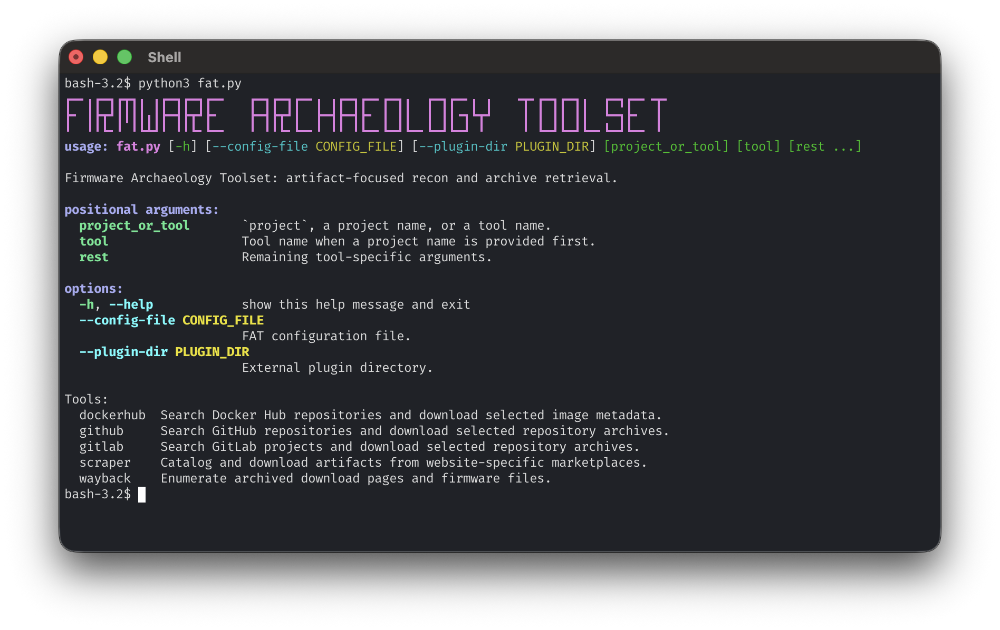

# Firmware Archaeology Toolset

[](https://github.com/NozomiNetworks/firmware-archaeology-toolset/actions/workflows/tests.yml)

FAT is a stateful, project-oriented tool for artifact hunting: find likely
firmware images, SDKs, container images, and other downloadable artifacts
across public sources, triage them, and retrieve them, including archived
copies from the Wayback Machine.

Discovery and retrieval stay in one place. Projects, keywords, findings,
selections, and download history persist in a single `.fat.json` state file, so
you can run one tool at a time and pick up where you left off.



## Start here

- [Contributing guide](CONTRIBUTING.md)
- [Plugin author guide](plugins/README.md)
- [Wayback parser guide](plugins/wayback/PARSER_HOWTO.md)
- [Plugin API reference](docs/plugin-api/README.md)
- Agent playbooks: [investigation](skills/fat-investigation/SKILL.md) and [extension guide](skills/fat-extension/SKILL.md)

## Installation

The published CI configuration currently tests Python 3.14.7. Other Python
3.10+ versions may work but are not covered by the CI matrix. Outbound network
access is required for live discovery and archive retrieval. The normal FAT
runtime has no third-party dependencies. JavaScript-heavy scraper or Wayback
parsers can opt into the separately locked Playwright environment described in
the plugin guides.

```bash
git clone https://github.com/NozomiNetworks/firmware-archaeology-toolset.git
cd firmware-archaeology-toolset
python3 fat.py --help
```

The project is released under the [BSD 3-Clause License](LICENSE).

## Basic workflow

Create a project, set keywords, then run any plugin:

```bash
python3 fat.py project device-research --keywords "vendor sdk,vendor platform"
python3 fat.py github search
python3 fat.py github status
python3 fat.py github select 1,3
python3 fat.py github download selected
python3 fat.py report
```

Every plugin shares the same command surface: `status`, `options`, `search`,
`select`, `clear-selection`, `download`, and `set`. Bare plugin invocation
defaults to `status`. The `wayback` plugin adds `post` (re-run parser post
hooks) and `clear` (wipe snapshots, selections, history, and downloaded
files). All commands accept an optional project name prefix:

```bash
python3 fat.py device-research github status
python3 fat.py device-research report
```

Delete a project with `project delete`; without `--delete-downloads`, FAT
asks whether downloaded artifacts should be removed as well:

```bash
python3 fat.py project delete device-research
python3 fat.py project delete device-research --delete-downloads yes
```

Project names should avoid the command and plugin names `project`, `set`,
`lead`, `status`, `report`, `dockerhub`, `github`, `gitlab`, `scraper`, and
`wayback`. These names are reserved by the command router and cannot be used
reliably with the explicit `<project> <command>` form.

The global `--state-file` option may appear before or after the command:

```bash
python3 fat.py --state-file /tmp/fat.json project lead list
python3 fat.py project lead list --state-file /tmp/fat.json
```

External vendor plugins are loaded from `~/.fat/plugins/` by default. Configure
another directory in `~/.fat/config.json`:

```json
{"plugin_dir": "/opt/fat/plugins"}
```

Use `--plugin-dir PATH` for one command or `--config-file PATH` for another
configuration file. The public repository contains the generic Wayback engine
and the `httpbin` test parser; vendor scrapers and Wayback parsers are supplied
by the private plugin repository and installed with its `install.sh` script.
External plugins are trusted Python code and run with the same filesystem,
process, and network privileges as FAT.

## Leads

Record investigation leads (interesting links) in project state so they
survive across runs and agent sessions:

```bash
python3 fat.py project lead add https://vendor.example/support/model \
  --source portal --title "support page" --note "lists fw 3.2.1"
python3 fat.py project lead list
python3 fat.py project lead set 1 status acted
python3 fat.py project lead rm 2
```

`status` is one of `new` (recorded, not examined), `checked` (examined,
pending), `acted` (used as input to a FAT action), or `dead` (ruled out).
`source` is one of `portal` (vendor site), `web` (search or dorks), `writeup`
(blogs, talks, forums), `repo` (GitHub/GitLab), `image` (Docker Hub),
`archive` (wayback discovery), or `user` (user-provided). Duplicate URLs are
rejected; leads appear in `output/report.md` via `fat.py report`.

## Examples

Search a code forge or registry (same flow for `github`, `gitlab`,
`dockerhub`):

```bash
python3 fat.py github set per-query 50
python3 fat.py github set min-match-keywords 2
python3 fat.py github set max-requests 25
python3 fat.py github set max-enrichments 8
python3 fat.py github set cache-ttl 3600
python3 fat.py github search
```

Source searches use a run-local request budget and deduplicate candidates
before fetching README content. `per-query` controls the provider page size;
`max-requests` and `max-enrichments` control the total work in that run. Set
`request-delay` when a service needs pacing, and set `cache-ttl 0` to disable
the successful-response cache. The defaults are 50 requests, 10 README
enrichments, no delay, and a 3600-second cache lifetime. These limits apply to
one plugin search invocation, not the whole investigation. The cache lives at
`output/.fat-cache/<plugin>`; use `cache-ttl 0` for a fresh run, or remove that
plugin directory to clear existing entries. Rate limits and request
diagnostics are recorded in `.fat.json` and `output/report.md`, and stop the
affected request path without a blind retry or fallback burst. Docker Hub has
no README enrichment stage, so `max-enrichments` has no effect there.
Source discovery is paginated within `max-requests`: FAT requests page 1 for
every keyword first, then follows later pages round-robin until each provider
search is complete, the request budget is exhausted, or a provider limits the
run. GitHub reports provider-capped or incomplete responses, GitLab follows
its `X-Next-Page` header, and Docker Hub follows its returned `next` URL. The
search diagnostics in `.fat.json` and `output/report.md` identify pages fetched
and any partial query. A run with some results and an interrupted query is
reported as `partial`; increase `max-requests` only when the additional
upstream work is intended. GitLab HTML fallback is identified separately from
API pagination completion.

Scrape a vendor download site after installing the private scraper repository:

```bash
python3 fat.py scraper set parser <external-parser>
python3 fat.py scraper set website https://vendor.example/downloads
python3 fat.py scraper search
python3 fat.py scraper select 1,2
python3 fat.py scraper download selected
```

Enumerate and retrieve archived artifacts with the Wayback plugin:

```bash
python3 fat.py wayback set parser <external-parser>
python3 fat.py wayback set target-url https://vendor.example/download
python3 fat.py wayback search snapshot
python3 fat.py wayback select 1,2
python3 fat.py wayback search firmware
python3 fat.py wayback select 2:1,2:2
python3 fat.py wayback download selected
```

Outputs land in `output/report.md` (human-readable report) and
`output/downloads/` (artifacts).

## Testing

The regular suite runs offline. The source-plugin integration checks try the
live services first and fall back to small API-shaped fixtures when an
upstream service is unavailable or rate-limited. The Wayback integration suite
exercises the live archive first and automatically falls back to a recorded local mirror
(`tests/wayback_mirror.py`) when web.archive.org is unreachable or throttling;
the backend used per test is printed in the run summary. Force a Wayback
backend with `FAT_WAYBACK_INTEGRATION_MODE=live|mirror` (default `auto`):

For source-plugin integration checks, use
`FAT_SURFACE_INTEGRATION_MODE=live|fixture` (default `auto`) to force the live
service or deterministic fixture backend. To make the complete integration
run deterministic, select both fixture backends:

```bash
FAT_SURFACE_INTEGRATION_MODE=fixture \
FAT_WAYBACK_INTEGRATION_MODE=mirror \
  python3 -m unittest discover -s tests -p 'integration_*.py' -v
```

```bash
python3 -m pip install --require-hashes --only-binary=:all: -r requirements-test.txt
python3 -m coverage run --branch -m unittest discover -s tests -p 'test_*.py' -v
python3 -m coverage run --branch -a -m unittest discover -s tests -p 'integration_*.py' -v
python3 -m coverage report --precision=2 --fail-under=80
```

The browser-rendering integration check is separate because it installs the
hash-locked Playwright package and its matching Chromium runtime:

```bash
./scripts/run_browser_tests_container.sh
```

To install all locked development dependencies, including the Playwright browser
runtime, run:

```bash
./scripts/install_dependencies.sh
```

Run it from a virtual environment when the host Python is externally managed:

```bash
python3 -m venv .venv
. .venv/bin/activate
./scripts/install_dependencies.sh
```

Use `./scripts/install_dependencies.sh --browser` for browser support only.
The Chromium version is selected by the pinned Playwright release.

For a generic manual browser check, `https://quotes.toscrape.com/js/` is a
small JavaScript-rendered page whose quote elements appear after browser
execution. Live vendor pages are useful for manual validation but are not
used as TDD fixtures.

Before opening a pull request, run the local quality gate. It regenerates the
committed API reference with the pinned documentation environment, runs the
containerized checks, and reports whether the branch is ready:

```bash
./scripts/prepare-pr.sh
```

CI runs the unit, integration, browser integration, and docs jobs on every
pull request.

## Extending

Drop a top-level plugin module or package into `plugins/`, expose `PLUGIN_CLASS`,
and implement the expected methods; it is discovered automatically at runtime.
Vendor scraper and Wayback parser modules belong in the private external plugin
repository and are copied into the configured plugin directory by its
`install.sh` script. See the [plugin author guide](plugins/README.md) for the
contracts.

## Repository map

- `fat.py`: CLI entry point
- `fatlib/`: shared project, HTTP, discovery, and report helpers
- `plugins/`: plugin base and implementations (`dockerhub`, `github`, `gitlab`, `scraper`, `wayback`)
- `docs/`: generated plugin API reference
- `skills/`: agent playbooks for operating and extending FAT
- `tests/`: offline unit tests and live integration tests
- `scripts/`: docs build and container test scripts
